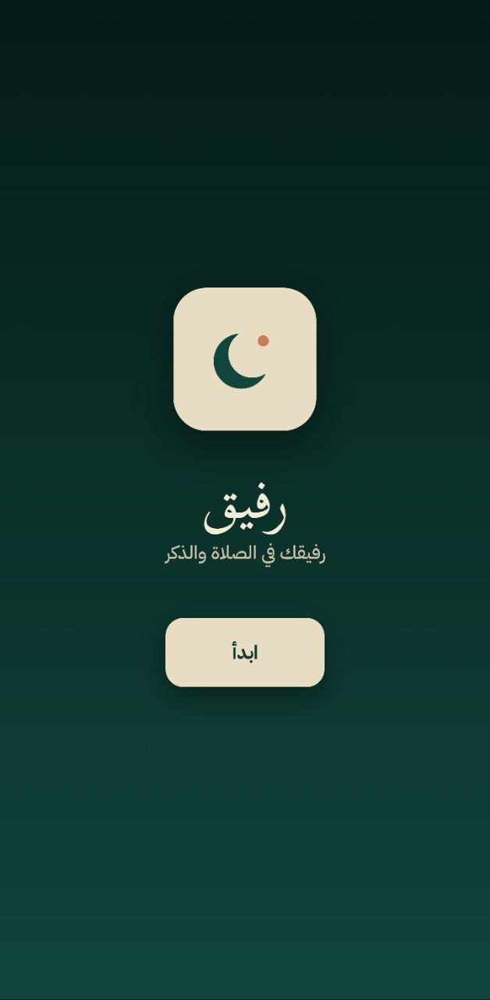
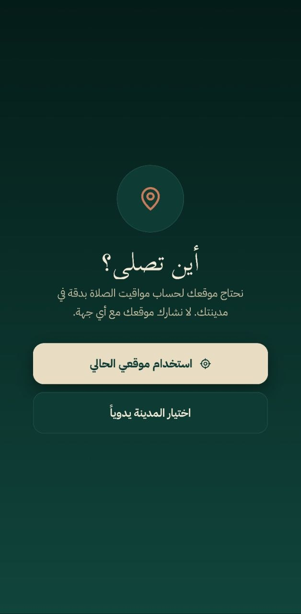
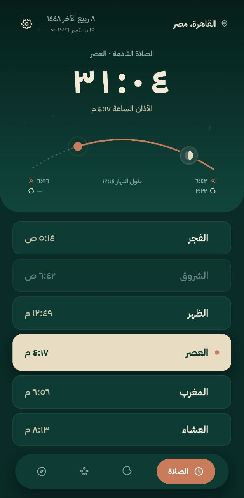
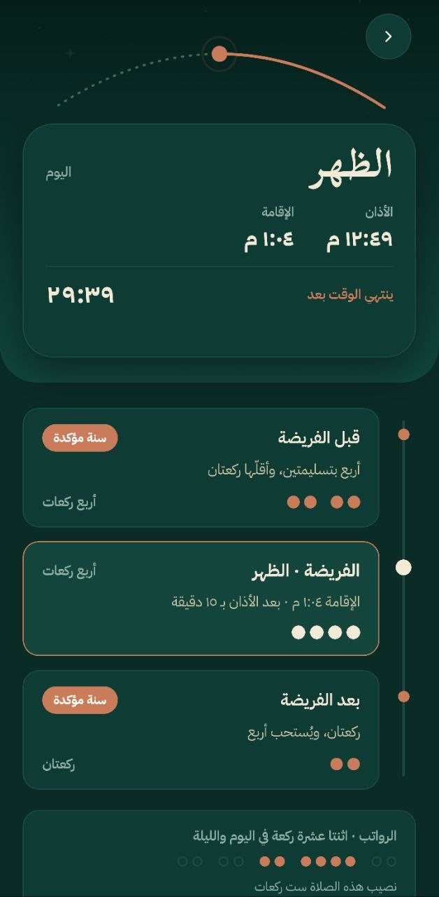
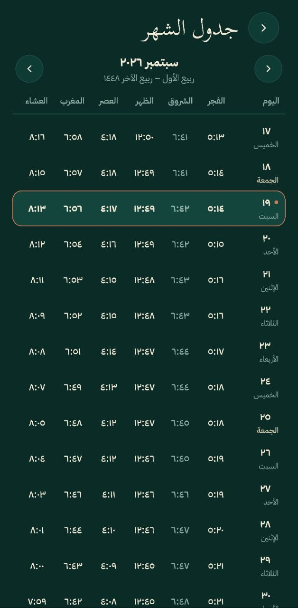
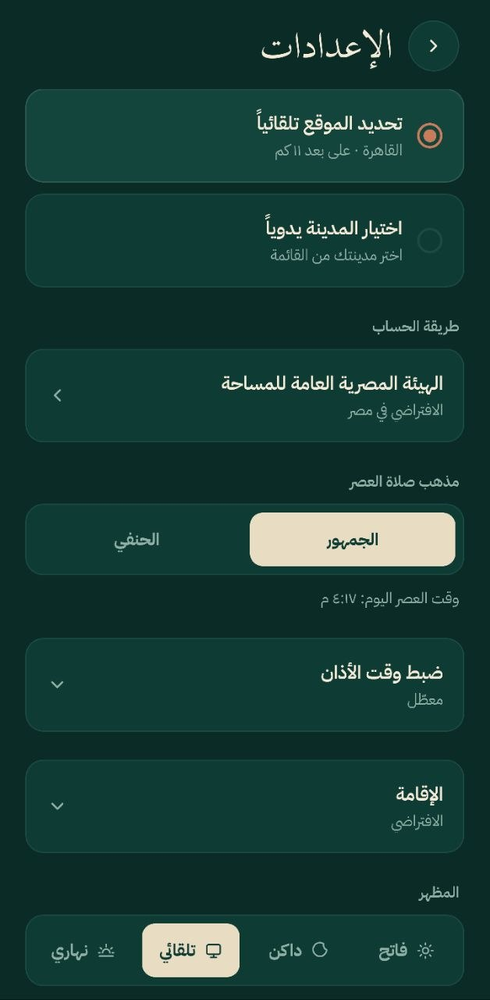
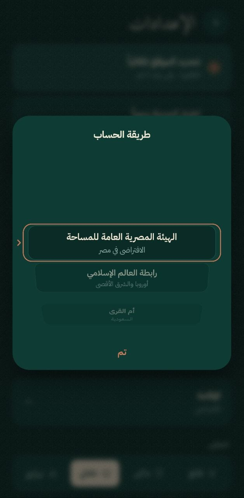

# رَفِيق · Rafiq

**رفيقك في الصلاة والذكر** — an Arabic-first, right-to-left prayer-times companion for Android and iOS, built with Expo.

Rafiq shows the next prayer with a live countdown, today's full timetable, the Hijri date, and a sun-and-moon arc that tracks the day. It is ad-free, works offline, and is designed to be calm rather than busy.

<p align="center">
  
  
  
  
  
  
  
</p>

## Features

- **Live countdown** in Arabic-Indic digits that follows the mosque rhythm: the next adhan, then its iqama, then (after Fajr) sunrise.
- **Daily timetable** for Fajr, Sunrise, Dhuhr, Asr, Maghrib and Isha with each prayer's iqama time, and the upcoming moment highlighted.
- **Per-prayer pages** opened from the timetable: the pressed row morphs into a hero card under a sky band, followed by an animated timeline of the Sunnah rak'ah before and after the fard (Witr after Isha, Jumu'ah on Fridays, Duha from the sunrise row).
- **Morning and evening azkar** behind a sun and moon dial: drag it and the sun sets, the moon rises and the sky turns with them. It opens on the set the hour calls for (morning from Fajr, evening from Asr). The reader shows one zekr per page; tap anywhere to count and a bead slides across a hanging tasbih strand. Progress is kept for the day and starts fresh at Fajr.
- **Sun and moon arc** that moves across the header during the day and turns into a moon with stars at night.
- **Hijri date** shown next to the location.
- **Onboarding** with a location step: use the device location or pick a city manually.
- **Settings** for location mode, calculation method, Asr madhab (الجمهور / الحنفي), per-prayer fine-tuning of the adhan minutes, the iqama delay per prayer, and appearance (light, dark, daylight, or follow the system).
- **Fully RTL and Arabic**, using IBM Plex Sans Arabic for UI text and Scheherazade New for display text.
- **Persistent preferences** stored on device with `expo-sqlite/kv-store`.

## Repository layout

| Path | What it is |
| --- | --- |
| `Rafiq/` | The Expo application. Everything you run and build lives here. |
| `Rafiq/src/` | Application source: routes, prayer feature, shared theme, storage, and UI kit. |
| `Rafiq/assets/images/` | App icons, splash images, and favicon. |
| `docs/screenshots/` | Screenshots used in this README. |
| `LICENSE` | GPLv3 license text. |

## Tech stack

- [Expo SDK 57](https://docs.expo.dev/versions/v57.0.0/) with React Native 0.86 and React 19
- [Expo Router](https://docs.expo.dev/router/introduction/) for file-based navigation
- [React Native Reanimated 4](https://docs.swmansion.com/react-native-reanimated/) for animation
- [react-native-svg](https://github.com/software-mansion/react-native-svg) for the arc, mark, icons, and gradients
- `expo-sqlite/kv-store` for local persistence
- `expo-localization` to force right-to-left layout at build time
- TypeScript in strict mode, ESLint via `eslint-config-expo`

## Getting started

### Prerequisites

- Node.js 20 or newer and npm
- For Android: Android Studio with an SDK, and a device or emulator
- For iOS: Xcode on macOS
- [EAS CLI](https://docs.expo.dev/eas/) if you want cloud builds (`npm i -g eas-cli`)

Rafiq uses native modules and forces RTL through a config plugin, so it runs in a **development build**, not in Expo Go.

### Install and run

```bash
cd Rafiq
npm install

# Generate the native projects (needed after cloning or after changing app.json)
npx expo prebuild --clean

# Build and install on a connected Android device or emulator
npx expo run:android

# Or on an iOS simulator (macOS only)
npx expo run:ios
```

After the first native build, day-to-day development only needs the Metro server:

```bash
npx expo start
```

Open the installed Rafiq dev build and it will connect to Metro and hot-reload as you edit.

### Cloud builds with EAS

Build profiles are defined in `Rafiq/eas.json`:

```bash
cd Rafiq
eas build --profile development --platform android   # dev client for testing
eas build --profile preview --platform android       # internal distribution
eas build --profile production --platform android    # store build
```

### Checks

```bash
cd Rafiq
npx tsc --noEmit     # type check
npx expo lint        # ESLint
npx expo-doctor      # dependency and config health
```

## App structure

```
Rafiq/src
├── app/                 Routes only (Expo Router)
│   ├── _layout.tsx      Fonts, splash, RTL bootstrap, settings provider, route guards
│   ├── onboarding.tsx   Welcome and location steps
│   ├── index.tsx        Home: countdown, sun arc, timetable, tab bar
│   └── settings.tsx     Location, calculation method, madhab, appearance
├── features/prayer/     Timetable, next-prayer logic, countdown hook, sun-arc math and SVG
└── shared/
    ├── theme/           Light and dark tokens, theme hook
    ├── storage/         Settings context and key-value persistence (native and web)
    ├── lib/             Arabic digits, 12-hour formatting, Hijri date, motion helpers
    └── ui/              Text, buttons, radio cards, segmented control, chips, tab bar, toast, icons
```

Routing is guarded: until onboarding is completed the app only exposes the onboarding screen, and afterwards it only exposes home and settings. The onboarding state, theme, city, method, and madhab are all persisted and restored synchronously at launch so there is no flash of the wrong screen or theme.

## Design

The UI is implemented from a Claude Design prototype that defines the palette, typography, layout, and interactions for all three screens. Brand colours:

| Token | Value |
| --- | --- |
| Paper | `#FBF8F1` |
| Sand | `#E8DCC3` |
| Teal ink | `#0E3C35` |
| Terracotta | `#C97B5A` |
| Bronze | `#A68A5B` |

Layouts use logical properties only (`start`/`end`, `marginStart`, `flexDirection: 'row'`) so they mirror correctly under RTL.

## Roadmap

- Real prayer-time calculation from the device location and the selected method and madhab (the current timetable is a fixed placeholder that the settings adjust).
- Adhan and pre-prayer notifications.
- More azkar categories beyond morning and evening.
- Tasbih and qibla tabs, which currently show a "coming soon" notice.
- Widgets and lock-screen surfaces.

## License

Rafiq is released under the GNU General Public License v3.0. See [LICENSE](LICENSE).
